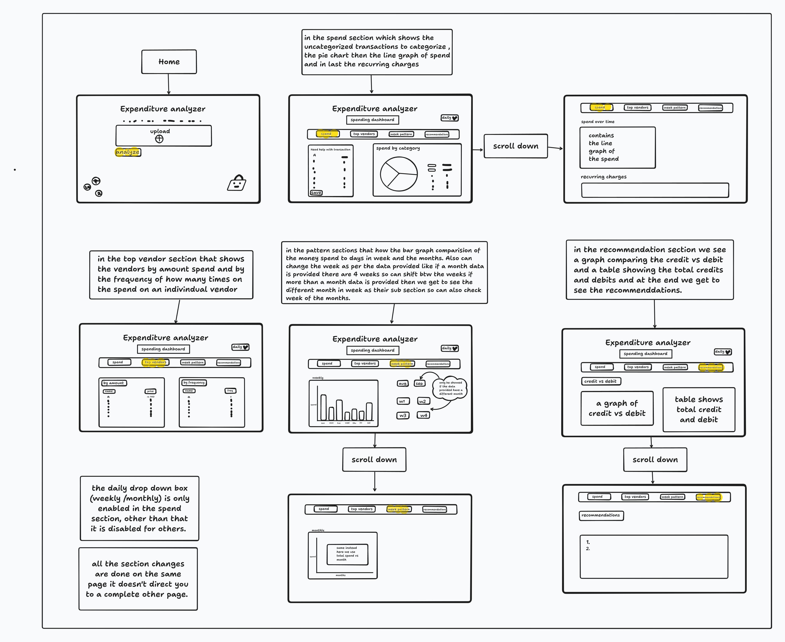
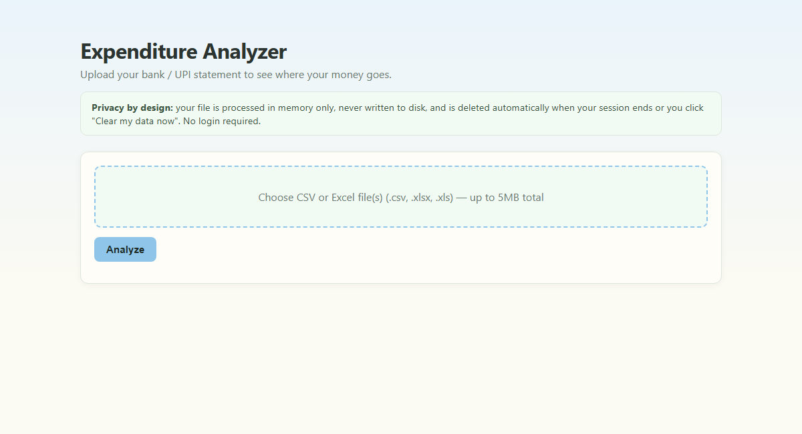
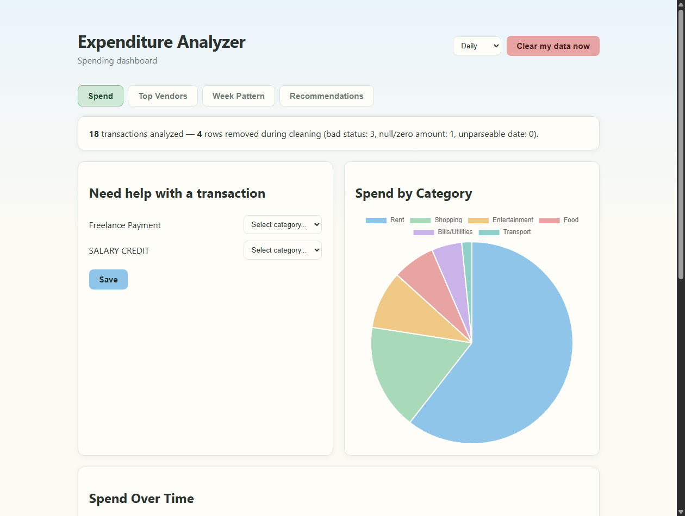
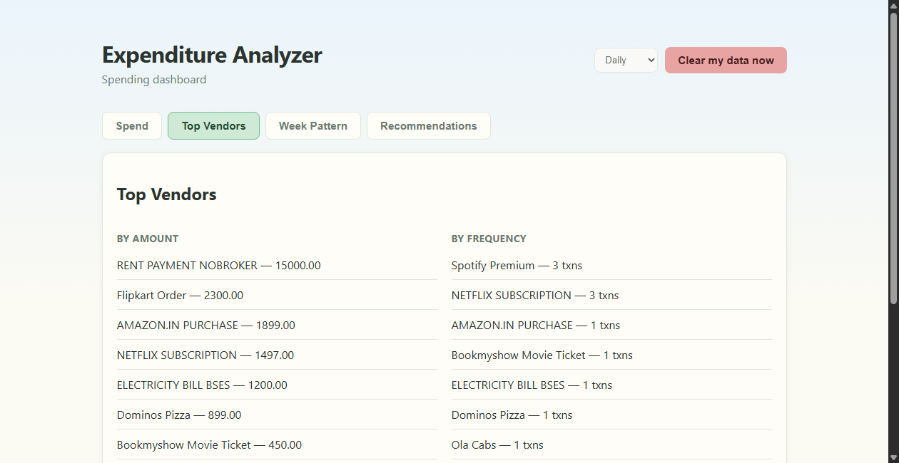
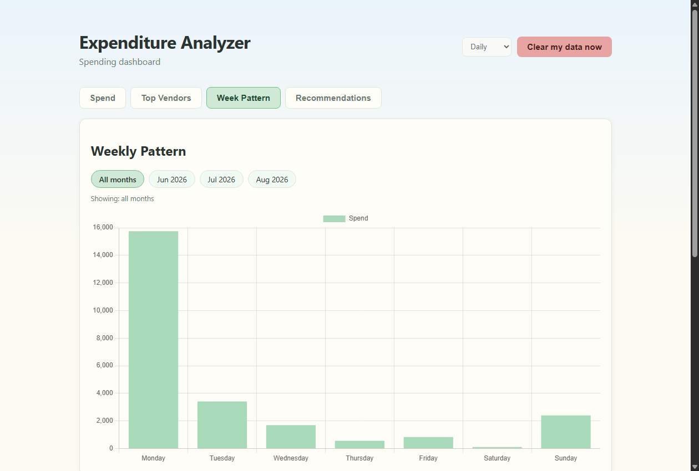
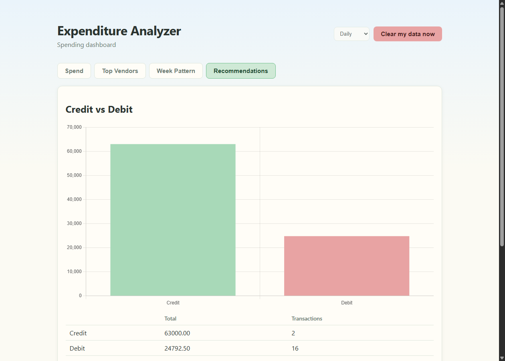

# Expenditure Analyzer

[Live demo](https://expenditure-analyzer-7hz9.onrender.com/)

Upload a bank / UPI statement (CSV or Excel) and get a spending dashboard —
category breakdown, trends over time, top vendors, recurring-charge
detection, and plain-language recommendations. No login, no database,
and no durable statement storage.

## Optional AI category suggestions

The dashboard can suggest categories for debit merchants that the local rules
do not recognize. This feature uses the [Groq API](https://console.groq.com/docs/structured-outputs)
only after the user checks the AI sharing box and clicks **Suggest categories
with AI**. The server sends one bounded batch of distinct merchant descriptions,
after replacing common UPI handles, numbers, links, and transaction references.
Free-text names may still remain after redaction. The uploaded file, amounts,
dates, and full transaction rows are not sent. Suggestions use the app's fixed
category list or `unsure`; every suggestion must be reviewed and saved by the
user. If Groq is unavailable, manual categorization continues to work.

Set `GROQ_API_KEY` as a server-side environment variable to enable suggestions.
`GROQ_MODEL` optionally overrides the default `openai/gpt-oss-20b` model and
must support Groq strict structured outputs. Do not put the key in the browser
or commit it to the repository. Groq's own [data controls](https://console.groq.com/docs/your-data)
govern data processed by its API; this app does not opt users into model
training or claim their corrections train a model automatically.

A separate checkbox lets users keep redacted merchant/category pairs as
evaluation examples **within the current in-memory session only**. They are
not sent to Groq or stored durably, and they disappear when the session is
cleared, expires, or the process restarts. A durable evaluation dataset would
need a separately designed store and consent flow.

## Why zero-persistence

Parsed transactions are held only in a per-session in-memory store keyed by a
random session ID in an httpOnly cookie. There is no database or durable file
storage. FastAPI's `UploadFile` may temporarily spool larger incoming files to
disk while receiving them; the app does not keep that upload file after request
processing. The parsed session data is dropped when:
- the user clicks **Clear my data now**,
- the session goes 30 minutes idle (background TTL sweep), or
- the process restarts.

This trades multi-instance scalability for a much smaller trust surface:
swap `app/core/session_store.py` for Redis and nothing else in the app
needs to change if horizontal scaling is ever needed.

## Getting started

Clone the repo:

```bash
git clone https://github.com/CodedBankai/expenditure-analyzer.git
cd expenditure-analyzer
```

Set up a virtual environment and install dependencies:

```bash
python -m venv .venv
source .venv/Scripts/activate   # Windows Git Bash; use .venv\Scripts\activate on cmd/PowerShell, or source .venv/bin/activate on macOS/Linux
pip install -r requirements.txt
```

Run the app:

```bash
uvicorn app.main:app --reload
```

Then open http://127.0.0.1:8000 and upload one of the files in
`sample_data/` to try it without a real statement.

Run tests:

```bash
pytest tests/ -q
```

## UI

The dashboard is a single page with four tabs (Spend, Top Vendors, Week
Pattern, Recommendations) — switching tabs never navigates away, it just
toggles which section is visible. The Week Pattern tab lets you drill into
a specific month and, within it, a specific week (only offered when the
data spans more than one month), then compares that against a total
spend-by-month view. This was designed from a hand-drawn sketch:



The light theme (white / cream / light green / light blue) was built from
a separate reference image, not copied 1:1.

### Screenshots

**Home — upload**



**Spend tab** — uncategorized-transaction helper, category breakdown, spend over time



**Top Vendors tab** — by amount and by frequency



**Week Pattern tab** — day-of-week spend, drillable by month/week



**Recommendations tab** — credit vs debit, plain-language suggestions



## How it works (pipeline)

```
Upload (CSV/Excel)
  -> Format detection & parsing      (app/core/parsing.py)
  -> Schema normalization            (app/core/parsing.py)
  -> Cleaning                        (app/core/cleaning.py)
  -> Categorization                  (app/core/categorize.py)
  -> Analysis / aggregation          (app/core/analysis.py)
  -> Recommendation engine           (app/core/analysis.py)
  -> Dashboard (Chart.js, client-side render only)
  -> Session-end purge               (app/core/session_store.py)
```

Two known column-layout profiles are auto-detected (a debit/credit bank
export and a signed-amount UPI export — see `sample_data/`), with a generic
heuristic sniffer as fallback and a manual column-mapping screen if that
sniffer isn't confident.

## Deployment

**Render — supported, via `render.yaml` (auto-detected as a Blueprint):**
connect the repo at [render.com](https://render.com), and it picks up
`render.yaml` automatically — one persistent Python web service, health
check on `/health`, no manual config needed. This works because Render
runs the app as a single long-running process, which is exactly what the
in-memory session store in `app/core/session_store.py` requires (see
"Why zero-persistence" above). Do not enable autoscaling / multiple
instances for this service — a second instance would not share the first
instance's session dict, and requests would randomly 404 (same failure
mode as running uvicorn with `--workers > 1`).

**Vercel — not supported as-is.** Vercel runs Python apps as stateless
serverless functions: there's no guarantee that two requests from the
same browser session hit the same function instance, or that the process
even stays alive between requests. Since sessions live only in an
in-memory dict, `/upload` and a later `/session/{id}/analysis` call could
land on different instances with no shared memory, producing intermittent
404s. Making this app work on Vercel would require swapping
`session_store.py` for an external store (e.g. Vercel KV / Upstash Redis)
first — the same swap already called out as the fix for horizontal
scaling in general. No `vercel.json` is included, so as not to give
Vercel something to auto-detect and deploy in a broken configuration.

## Known limits (v1, by design)

- **Single process only.** The session store is an in-memory dict; do not
  run with `--workers > 1` or it'll produce intermittent 404s (see
  design.md §6.1). Swap in Redis behind `session_store.py` for horizontal
  scaling.
- **Upload cap:** 5MB total / 10,000 rows per session.
- **Concurrent session cap:** 50 (returns 503 past that, to bound memory).
- Cross-file duplicate-row detection is not implemented (v1.1 idea).
- PDF statements, login/accounts, and real bank integrations are out of
  scope for v1 (see requirements.md §4).

## Project layout

See `app/` for the FastAPI app (`routes/` = HTTP layer, `core/` = pure,
independently unit-testable logic), `tests/` for unit tests, and
`sample_data/` for synthetic statements used in both tests and manual
demoing.
